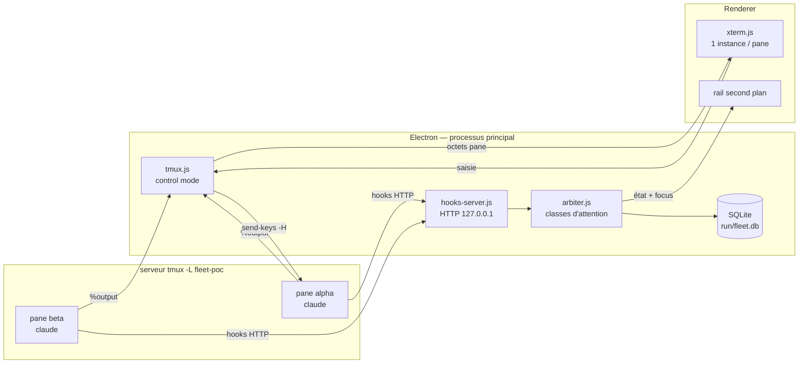
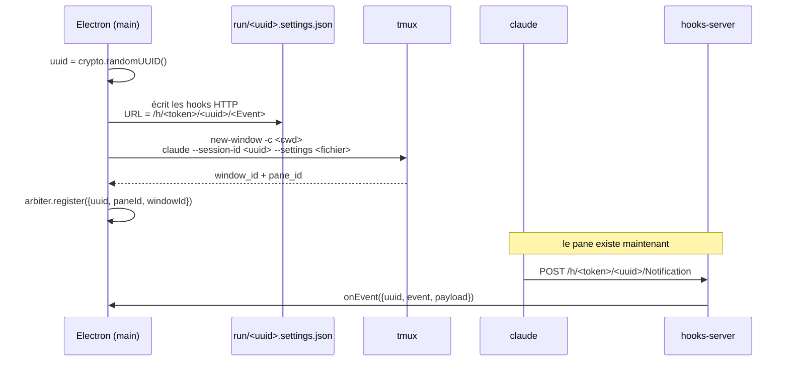
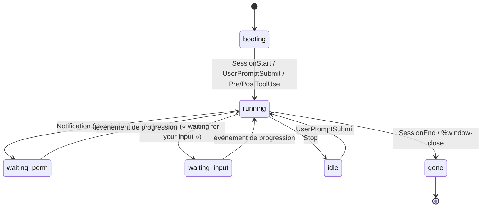
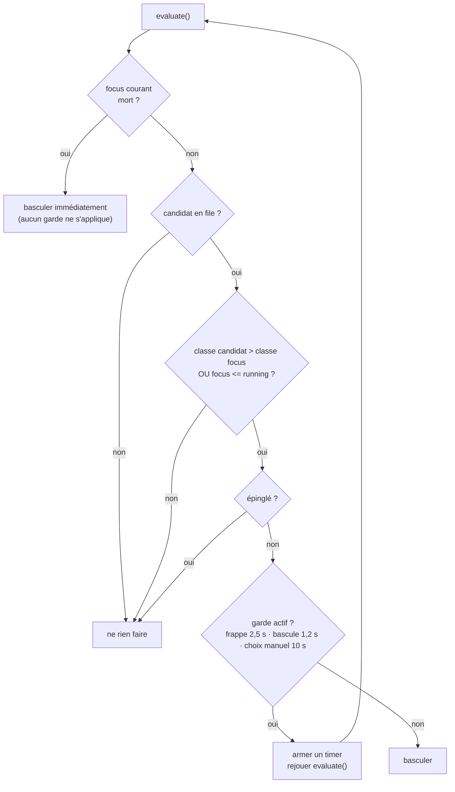

# ADR 0001 — Arbitrage de l'attention sur une flotte de sessions Claude Code

- **Statut** : accepté
- **Date** : 2026-09-16
- **Portée** : `src/main/tmux.js`, `src/main/session-settings.js`, `src/main/hooks-server.js`, `src/main/arbiter.js`

## Contexte

Faire tourner plusieurs sessions Claude Code en parallèle bute sur un seul
problème : **elles demandent toutes l'attention d'un humain, et l'humain n'a
qu'un écran**. Chaque session alterne entre travail autonome (long, silencieux)
et blocage sur une interaction (prompt de permission, question, fin de tour).

Les approches naïves échouent toutes :

| approche | pourquoi elle casse |
|---|---|
| un onglet par session, navigation manuelle | l'humain devient l'ordonnanceur ; il surveille au lieu de travailler |
| split screen à N panes | à 3 sessions le texte est illisible, et 90 % de la surface affiche du travail autonome |
| polling de l'écran (`capture-pane`, scraping) | on devine un état au lieu de le lire ; latence et faux positifs |
| tout en avant-plan, notifications OS | l'humain trie les notifications ; aucune priorité entre deux demandes |

Il faut donc trois briques distinctes :

1. **exécuter** N terminaux réels dont un seul est visible, sans que les autres
   se figent ;
2. **savoir** ce que fait chaque session, de façon fiable et non devinée ;
3. **décider** lequel mérite l'écran, automatiquement et sans scintillement.

## Décision

### Vue d'ensemble

### 1. tmux en control mode comme moteur d'exécution

`tmux -C attach-session` sur un **serveur dédié** (`-L fleet-poc`, `-f /dev/null`
pour ignorer le `~/.tmux.conf` de l'utilisateur), **une fenêtre par session**.

Le point décisif : le control mode émet `%output` **y compris pour les fenêtres
en arrière-plan**. Toutes les sessions continuent donc de rendre en permanence.

> Changer de session d'avant-plan est un **basculement de visibilité**, pas un
> rejeu d'historique : aucune reconstruction d'écran, aucune perte de scrollback.

Le canal tourne sur des pipes simples, sans pty. Deux détails de protocole :

- `%output` échappe les octets non imprimables en **octal à trois chiffres** et
  laisse passer les octets `>= 0x80` bruts. Le flux est donc lu en `latin1`
  (un caractère = un octet) puis re-décodé en `Buffer` — l'UTF-8 survit intact.
- la saisie repart en `send-keys -H <hex>` : des octets littéraux, donc **aucun
  quoting** et **aucune interprétation de noms de touches**. Les séquences
  d'échappement produites par xterm.js passent verbatim.

### 2. Jonction session Claude ↔ pane tmux : l'identité précède le pane

Le piège : les hooks HTTP sont émis par Claude Code lui-même, sans sous-processus.
`$TMUX_PANE` n'est **jamais** hérité et ne peut pas servir de clé de jointure.
Toute jointure *a posteriori* (registre, handshake) introduit une course.

La jonction est donc faite **par construction**, avant que le pane n'existe :

Conséquences :

- **la jonction est un routage d'URL** — pas de handshake, pas de course ;
- `--settings` se **fusionne** par-dessus la configuration de l'utilisateur :
  rien de la flotte ne fuit dans son Claude Code normal ;
- ce fichier force `permissions.defaultMode: "default"` **pour ces sessions
  seulement**. Sans ça, aucun prompt de permission ne se déclenche et il n'y a
  plus rien à arbitrer ;
- un `token` aléatoire par lancement ferme l'endpoint de loopback ;
- le serveur répond `200` **avant** de traiter la charge utile : une session ne
  bloque jamais sur l'interface.

### 3. Le système d'attention

#### Événements → classe d'attention

Chaque hook fait transiter la session dans un état, et chaque état porte une
**classe** : l'avant-plan affiche toujours la classe la plus haute.

| classe | état | signification | avant-plan |
|---|---|---|---|
| 3 | `waiting_perm` | prompt de permission bloquant | oui |
| 2 | `waiting_input` | relance d'inactivité | oui |
| 1 | `idle` | tour terminé, attend une instruction | oui |
| 0 | `running` / `booting` | travaille seule | jamais |
| -1 | `gone` | `SessionEnd` ou pane mort | libéré immédiatement |

Les événements de progression (`SessionStart`, `UserPromptSubmit`, `PreToolUse`,
`PostToolUse`) servent de **preuve que la session est repartie seule** : sa
revendication sur l'humain est périmée, la classe retombe à 0.

#### La décision de focus

`evaluate()` est **idempotente** : un garde ne l'annule pas, il la reporte, et un
timer la rejoue à l'expiration.

Deux invariants empêchent la bascule automatique de dégénérer en scintillement :

- **égalité = maintien du titulaire.** Une session qui pose déjà une question à
  l'humain n'est jamais préemptée par une revendication de même classe.
- **les gardes reportent, n'annulent jamais.** Frappe récente (2,5 s), bascule
  récente (1,2 s), choix manuel (10 s) et épingle repoussent la bascule ; la
  décision est rejouée telle quelle ensuite.

La seule exception : un pane mort est quitté immédiatement, gardes compris —
regarder un terminal mort n'a aucune valeur.

Tout ce qui n'est pas l'avant-plan est **second plan** : une barre de chips
montrant état, rang dans la file et ancienneté. La file est triée par classe
décroissante puis par ancienneté (`since`), donc une demande ancienne de classe
égale passe devant.

## Conséquences

**Acquis**

- L'humain ne navigue plus : il répond à ce qui est à l'écran.
- L'état vient des hooks de Claude Code, pas d'un scraping de terminal — c'est
  lu, pas deviné.
- Toutes les sessions restent vivantes et rendues ; la bascule est instantanée.
- L'arbitre est une machine à états pure (horloge et timers injectés), testable
  hors Electron (`test/arbiter.test.js`).
- Le journal `hook_events` est append-only et survit aux relances : on peut
  rejouer l'historique d'attention d'une flotte.

**Coûts assumés**

- Dépendance dure à tmux 3.6 et au format `%output` du control mode — vérifié,
  mais non contractuel entre versions.
- Dépendance au format des hooks Claude Code ; `waiting_input` est distingué de
  `waiting_perm` par une **correspondance sur le texte** du message
  (`/waiting for your input/i`), donc fragile à une reformulation amont.
- `permissions.defaultMode: "default"` imposé : ces sessions posent réellement
  des questions, elles ne sont pas autonomes de bout en bout.
- Electron possède le cycle de vie tmux : chaque lancement repart d'une flotte
  propre (les tables `sessions` et `queue` sont vidées au démarrage).
- Les constantes de garde (2,5 s / 1,2 s / 10 s) sont empiriques et non encore
  validées sur une flotte de plus de deux sessions.

## Alternatives écartées

| alternative | raison du rejet |
|---|---|
| pty direct par session (`node-pty`) | il faudrait réimplémenter multiplexage, scrollback et survie au crash de l'interface ; tmux les donne |
| `capture-pane` en polling | état deviné, latence, charge CPU ; les hooks donnent des transitions exactes |
| hooks en commande shell (au lieu de HTTP) | un sous-processus par événement, et il faudrait quand même router l'identité |
| `$TMUX_PANE` comme clé de jointure | jamais hérité : les hooks HTTP sont émis par Claude Code, sans sous-processus |
| registre / handshake d'enregistrement | course entre le premier hook et l'enregistrement ; l'uuid frappé en amont l'élimine |
